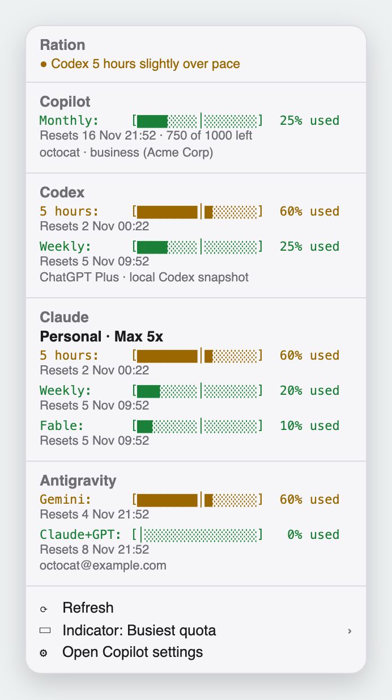

<h1 align="center">Ration</h1>

<p align="center"><strong>Know from your menu bar whether your AI quota will last to reset day.</strong></p>

<p align="center">
  <a href="https://github.com/shkao/ration/actions/workflows/ci.yml"></a>
  <a href="LICENSE"></a>
  
</p>

<p align="center">
  <picture>
    <source media="(prefers-color-scheme: dark)" srcset="assets/ration-dark.png">
    
  </picture>
</p>

Copilot premium requests, Codex limits, Claude plan limits, Antigravity quotas: each is a fixed ration, and nothing warns you when you're spending it too fast. Ration is a [SwiftBar](https://github.com/swiftbar/SwiftBar) plugin that keeps your usage in the menu bar and turns it orange, then red, the moment you're ahead of pace.

- **Pace, not just percent.** Every bar marks your fair share for right now.
- **Four providers, zero API keys.** It reuses the sign-ins you already have.
- **Every Claude account.** Personal and work side by side, each with its own bars.
- **Synced across Macs.** Usage from your other laptop shows up through iCloud Drive.

## Quick start

```bash
brew install --cask swiftbar && brew install jq
git clone https://github.com/shkao/ration.git && cd ration
./install.sh
```

Point SwiftBar at the folder `install.sh` prints (**Preferences > Plugins > Plugin Folder**, default `~/.swiftbar-plugins`). Set up at least one provider below; Ration shows a section for each one it finds and setup steps when it finds none.

## Providers

| Provider | You need | Ration reads |
|---|---|---|
| **Copilot** | [GitHub CLI](https://cli.github.com/) signed in (`gh auth login`) with a Copilot seat | Monthly premium requests from `gh api /copilot_internal/user` |
| **Codex** | Codex app or CLI signed in (`codex login`) | 5-hour and weekly limits from ChatGPT's usage endpoint, falling back to local session snapshots |
| **Claude** | Claude Code signed in (`/login`) on a Pro, Max, Team, or Enterprise plan | 5-hour, weekly, and per-model weekly limits, the numbers `/usage` shows |
| **Antigravity** | [`antigravity-usage`](https://github.com/skainguyen1412/antigravity-usage) (`npm install -g antigravity-usage`, then `antigravity-usage login`) | Two weekly quotas: Gemini models, and Claude plus GPT models |

To watch only some of them, list the ones to keep in `~/.config/ration/providers`. Ration never fetches the rest; delete the file to show everything again.

```bash
mkdir -p ~/.config/ration && printf 'codex\nclaude\n' > ~/.config/ration/providers
```

### More than one Claude account

Ration finds every account Claude Code has signed in on this Mac, one per config folder, with no setup:

```bash
claude                                    # personal account, ~/.claude
CLAUDE_CONFIG_DIR=~/.claude-work claude   # then /login with the work account
```

Team and Enterprise accounts are named by their organization; others read as Personal.

## Reading the bars

```
5 hours:    [████████░░░│░░░░]  52% used
Weekly:     [██████████│███░░]  81% used
```

The tick (`│`) is your fair share by now, where usage would sit if you spread it evenly to reset day.

- **Fill behind the tick:** on pace. The number stays green.
- **Fill past the tick:** you're borrowing from tomorrow. The number warms to orange, then red, and at the worst state the icon becomes a warning triangle so it doesn't rely on color.
- **100%:** Ration stops pacing and counts down instead: see you on reset day.

## Choosing what the menu bar shows

By default the menu bar shows a gauge and your busiest quota across every provider. **Indicator** in the dropdown changes that:

| Choice | Menu bar shows |
|---|---|
| **Busiest quota** (default) | The highest usage across all providers |
| **All providers** | Each provider and Claude account side by side, or one window across them (5 hours or Weekly) |
| A single provider | That provider alone, with its logo in place of the gauge and its own pace color |
| A single limit | One window, such as Codex's 5 hours or Claude's weekly limit |
| A Claude account, or **Each account** | One account, or every account by initial (`P 40% · A 62%`) |

Provider and limit choices combine, so **Each account** with **Weekly** compares every account's weekly limit. In the side-by-side views, Claude accounts sit after a sun mark as plan symbols, a person for personal plans and a building for Team and Enterprise; the tooltip names each one. Your choice is saved in `~/.config/ration/menubar-source`.

<details>
<summary>Separate Codex and Claude icons</summary>

To show Claude as its own menu bar item, install the second plugin and turn on the split layout:

```bash
cp ration-claude.1m.sh ~/.swiftbar-plugins/
mkdir -p ~/.config/ration && touch ~/.config/ration/split-indicators
open -g 'swiftbar://refreshallplugins'
```

In an **All providers** view, both items follow the selected limit and other providers stay in the first item. Pick any other indicator to go back to one item.

</details>

## Syncing between Macs

Each Mac's Ration writes the Claude and Codex usage it fetched to `iCloud Drive/Ration/`: one small file per account with its fetch time and **never a token**. When this Mac can't fetch an account itself, for example because you only use it on your other laptop, it shows the newer copy, marked "fetched by another Mac".

Install Ration on each Mac and sign them into the same iCloud account. Without iCloud Drive, Ration skips this.

## How it works

Ration refreshes every minute (the `1m` in `ration.1m.sh`). Each provider shows when its data was fetched, and Ration works out pace locally from each limit's reset time and window length.

- **Copilot:** calls `gh api /copilot_internal/user`, the endpoint GitHub's own Copilot clients use. When GitHub is unreachable, the menu renders from cache with an offline note and a wifi-slash icon. Ration asks you to sign in only when your token is missing or rejected.
- **Codex:** asks `chatgpt.com/backend-api/wham/usage`, the endpoint behind Codex's `/status`, with the token in `~/.codex/auth.json`, so usage from other machines counts. If that fails, it reads the newest rate-limit snapshot under `~/.codex`, including resumed and archived sessions.
- **Claude:** reads each account's token from the macOS Keychain and asks `api.anthropic.com/api/oauth/usage`, the endpoint behind `/usage`, at most once every five minutes per account.
- **Antigravity:** runs `antigravity-usage --refresh` to bypass the CLI's cache. Ration finds the CLI on Homebrew's PATH or in an nvm-installed Node.

Tokens go to curl on stdin, so they never show in a process list or land in Ration's cache. Ration never refreshes a Codex or Claude token, since that would replace the one the app holds. An expired Claude token shows the cached numbers with a note; run `/usage` in that account's Claude Code to renew it. That note doesn't mean your subscription expired.

Good responses are cached in `~/Library/Caches/ration/`. A 15-second watchdog treats a stalled call as a network failure, so a bad connection falls back to the cache instead of hanging the refresh.

## Caveats

- `/copilot_internal/user`, `/api/oauth/usage`, and the Codex usage endpoint are undocumented and could change without notice.
- Copilot pace assumes a monthly cycle starting one calendar month before the reset date, which matches standard business and enterprise billing.
- When Codex's live request fails (offline, or a token Codex hasn't refreshed lately), its usage updates only after this Mac's Codex gets a response. ChatGPT web-chat limits aren't stored anywhere Ration can read.
- A window whose reset time passed since its last snapshot shows usage as unavailable until fresh data arrives.
- A Claude account you haven't used here for a while shows cached numbers until Claude Code renews its sign-in, or another Mac shares newer ones (iCloud can lag a minute or more).
- Antigravity shows percentages only; its CLI doesn't expose request counts.

## Development

```bash
./tests/run.sh
```

The suite runs the real plugin end to end in an isolated `$HOME`, against stub Copilot, Antigravity, Keychain, Claude API, and Codex usage API commands plus Codex session fixtures. It covers provider combinations, pace escalation, exhausted states, every error branch, concurrent fetches, the cache fallbacks, sharing between Macs, and installing into a custom plugin folder. CI runs it on macOS and ShellCheck on Linux.

<details>
<summary>Project layout</summary>

```
ration.1m.sh              the plugin, one self-contained script
ration-claude.1m.sh       optional second menu bar item
helpers/ration-login.sh   "Sign in with GitHub…" recovery action
install.sh                copies the plugin and login helper into place
tests/run.sh              integration tests
.github/workflows/ci.yml  ShellCheck on Linux, tests on macOS
```

SwiftBar runs one file per plugin and treats every executable in its folder as a plugin. So `ration.1m.sh` has no sourced libraries or build step, and the login helper lives in `~/.ration-helpers/`, where it can't fire `gh auth login --web` on every launch.

</details>

<details>
<summary>Custom install folder</summary>

`install.sh` derives every path from `$HOME` and copies no account data, so each user's install reads their own sign-ins. `SWIFTBAR_PLUGIN_DIR` is the only setting:

```bash
SWIFTBAR_PLUGIN_DIR="$HOME/path/to/swiftbar-plugins" ./install.sh
```

It also removes older Ration and QuotaPace plugins, so SwiftBar never runs two.

</details>

## Uninstall

```bash
rm -f ~/.swiftbar-plugins/ration.1m.sh ~/.swiftbar-plugins/ration-claude.1m.sh
rm -rf ~/.ration-helpers ~/Library/Caches/ration ~/.config/ration
rm -rf ~/Library/Mobile\ Documents/com~apple~CloudDocs/Ration
```

Use your own folder in the first line if you set `SWIFTBAR_PLUGIN_DIR`.

## Why "Ration"

A quota you set yourself is a budget. A quota your company hands you is a ration: someone else decided how much, it never feels like enough, and your job is making it last to distribution day. The tick is today's fair share, fill past it is bread eaten early, and at 100% Ration says what everyone at the back of the queue already knows: see you on reset day.

## License

[MIT](LICENSE)
